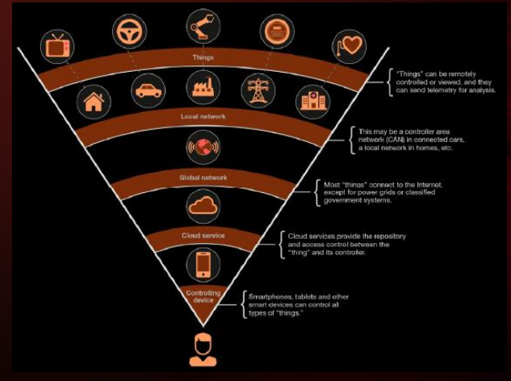

# Arquitetura de sistemas IoT

projetos de IoT precisar levar em conta 2 coisas indepedente das camadas:

- dispositivos possuem heterogenidade

- segurança do projeto      

## Composição da arquitetura

1. dispositivos heterogenios, de diferentes marcas, modelos etc..., 

2. os dispositivos vão estar conectados em uma mesma rede

3. dispositivos se comunicarão através de um gateway (um arduino uno, raspeberry PI e vários outros)

4. aplicações (softwares) que recebem e enviam dados a plataformas digitais

5. plataformas digitais que vão ser o aglomerado de dados. Essas platafomas vai ser possível analisar os dados, realizar ações depedendo deles etc...

